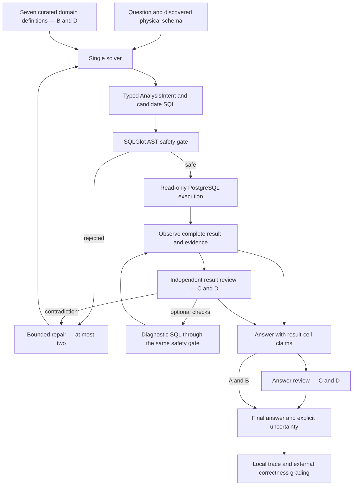

# Domain-Aware Analytics Agent

A PostgreSQL analytics agent that turns natural-language questions into read-only SQL and evidence-backed answers. The project tests a practical question: **do domain definitions and independent verification improve accuracy enough to justify their cost?**

The implementation includes typed analysis intent, SQL AST safety checks, a seven-entry domain dictionary, independent result review, diagnostic queries, bounded repair, and durable evidence traces. It uses the OpenAI Agents SDK and Responses API.

**Result:** on 34 paired Olist business questions, the basic agent and the simpler two-request baseline both scored **30/34 (88.24%)**. The full configuration scored **31/34 (91.18%)**, with no statistically significant improvement. The simpler baseline used **40.55% of the basic agent's estimated cost** and **49.51% of its mean latency**. These findings do not establish equivalence.

## Motivation

Executable SQL can answer the wrong business question. Denominators, entity grain, calendar boundaries, join fan-out, and NULL behavior matter even when syntax is valid. Conversely, extra verification can reject a correct answer or consume the time budget. This repository exposes both sides of that trade-off rather than treating an internal approval as proof of task correctness.

## Architecture



There is **no separate heavy Planner model call** in the final A–D implementation. The solver submits `AnalysisIntent` with its SQL tool arguments. Intent is fixed before execution and cannot silently change during repair. Its hash detects changes; it does not prove that the model understood the question.

The independent reviewer runs **after execution** and at the answer stage in C/D. It is a separate call/context using the same underlying model, not a separate development team. It may request up to two diagnostic queries. Earlier SQL-review prototypes are not the public entry point.

## Configurations

| Variant | Behavior |
|---|---|
| A | Basic solver + typed intent + read-only SQL; up to two repairs |
| B | A + relevant, schema-checked domain dictionary retrieval |
| C | A + independent result/answer review and optional diagnostic SQL |
| D | B + C |
| E | Generate SQL once → safety gate → execute once → generate an answer once; at most two API requests |

All five evaluated configurations used `gpt-6.1-sol`, medium reasoning, the same physical database schema and SQL execution boundary. A–D allow at most 12 model requests per session; E allows at most two. Failed sessions are not automatically restarted. The public CLI pins this model rather than silently changing an experiment through an environment override; live use requires model access on your account.

## Components

- [`analytics_agent_v1.py`](src/domain_aware_analytics/analytics_agent_v1.py): solver, typed intent, review, repair and final-answer evidence binding.
- [`domain_knowledge_v1.py`](src/domain_aware_analytics/domain_knowledge_v1.py): deterministic retrieval of seven source-curated definitions, checked against the live schema. Definitions are project conventions, not external business sign-off.
- [`analytics_safety_v1.py`](src/domain_aware_analytics/analytics_safety_v1.py): AST-based execution permission, object/function/type restrictions and schema resolution.
- [`analytics_observation_v1.py`](src/domain_aware_analytics/analytics_observation_v1.py): complete-result observation, NULL preservation, result comparisons and scoped semantic evidence.
- [`baseline_e.py`](src/domain_aware_analytics/baseline_e.py): the evaluated two-request control, without dictionary, explicit intent, repair or review.
- [`postgres.py`](src/domain_aware_analytics/postgres.py) and [`runtime.py`](src/domain_aware_analytics/runtime.py): portable database adapter, request budgets, zero SDK retries and Responses transport.

Inherited temporal/conditional SQL proof helpers are included because the final observation code imports them. The old V2/V3 backends, Streamlit app and historical benchmark runners are not required to run this publication.

## Evaluation design and results

Forty questions were independently prepared. The A–D run stopped on an unknown-usage reviewer timeout during question 35. The complete four-arm prefix, questions 1–34, was selected **after execution but before Gold retrieval and scoring**. All included failures remain in the denominator. E was added later on those same 34 questions.

| Variant | Main correct / 34 | Sensitivity correct / 34 | Mean estimated cost / task | Mean session latency |
|---|---:|---:|---:|---:|
| A | 30 — 88.24% | 32 — 94.12% | $0.00896 | 10.76 s |
| B | 31 — 91.18% | 33 — 97.06% | $0.00990 | 11.08 s |
| C | 28 — 82.35% | 30 — 88.24% | $0.03310 | 31.38 s |
| D | 31 — 91.18% | 33 — 97.06% | $0.03544 | 31.78 s |
| E | 30 — 88.24% | 31 — 91.18% | $0.00363 | 5.33 s |

Costs use recorded token usage and the study's frozen standard-price assumptions, **not invoices or a current price quote**. Means include all 34 assigned sessions, including failures. The sensitivity analysis accepts correctly rounded continuous means shown to two decimals; it does not forgive semantic errors or missing answers.

All exact two-sided McNemar comparisons were non-significant. A vs. E had 2:2 discordant outcomes (`p = 1.00`); B vs. C and D vs. C had 3:0 (`p = 0.25`). A 30/34 result has a Wilson 95% interval of **73.38%–95.33%**. Small samples and `p = 1` do not establish equivalence.

See [the public final summary](docs/FINAL_RESULTS_SUMMARY.md), [experimental protocol](docs/EXPERIMENTS.md), and [machine-readable aggregate measurements](results/aggregate_results.json). Private questions, reference SQL, answers and raw traces are deliberately not distributed.

## Two failure lessons

**T009 — verification overhead.** A primary query returned the reference-matching result. A reviewer-requested join-duplication check then hit the five-second database timeout, preventing a final answer. Additional checking can lower end-to-end reliability even when the first query is correct.

**T019 — business definition ambiguity.** All five configurations selected a plausible denominator including orders without item rows; the reference used item-bearing orders. Retrieved knowledge and reviewer approval did not resolve this underspecified population. Clarifying the business definition is a separate task from checking SQL execution. No private reference values or SQL are needed to explain this failure.

## Installation

The evaluated environment used **Python 3.11.17** and PostgreSQL 18.6. Exact direct Python dependency versions are recorded in `requirements.txt`; this is not a complete cross-platform lock or bundled environment.

```bash
python -m venv .venv
# Activate the virtual environment using your shell's standard command.
python -m pip install -r requirements-dev.txt
python -m pip install --no-deps -e .
```

No database, API key or paid requests are required for the offline tests/example. Package availability and live model access depend on your environment; no clean-room dependency installation or new live run was performed for publication.

## Offline demonstration and tests

```bash
python -B examples/offline_demo.py
python -B -m pytest tests -q
python -B scripts/verify_release.py
python -B scripts/scan_publication.py
```

The example uses an in-memory synthetic SQLite fixture and scripted SDK model responses. It demonstrates real tool dispatch and evidence flow, **not measured model accuracy or PostgreSQL parity**. The publication copy passed **114 offline tests**, wheel construction and packaged JSON-asset/import checks in the recorded environment. The offline suite blocks HTTP and PostgreSQL connections. See [testing notes](docs/REPRODUCIBILITY.md).

## Live usage

Use a database you administer with the required Olist tables, a dedicated SELECT-only role, and no schema-creation privilege. See [database assumptions](docs/DATABASE.md). The CLI reads process environment explicitly and does not automatically load `.env`. `.env.example` contains placeholders only.

Set `OPENAI_API_KEY`, `DB_HOST`, `DB_PORT`, `DB_NAME`, `DB_USER`, and `DB_PASSWORD` securely in your process environment; do not put secrets in command arguments or commit them. Disable remote Agents tracing with `OPENAI_AGENTS_DISABLE_TRACING=1`.

```bash
python -B scripts/run.py --variant D --question "Count orders by status." --output outputs/my-session --live
python -B scripts/run.py --variant E --question "Count orders by status." --output outputs/my-control --live
```

Each output directory must be new. These commands incur model charges and read the database. Raw local outputs may contain sensitive questions and data; `outputs/` is ignored and must not be published. `completed`, `verified`, and externally `correct` are different statuses. The CLI does not load Gold or score predictions.

## Security and limits

- Read-only database role plus `REPEATABLE READ READ ONLY`; five-second SQL timeout.
- One AST-checked read-only statement, allowed physical objects/functions/types; no shell, filesystem or Python tool exposed to the model.
- Complete results only: maximum 50 rows / 200,000 bytes; overflow is rejected rather than presented as a full population.
- A–D: 12 requests, two repairs, two verification queries, 50,000 observed tokens, 120 seconds per task; 30 seconds and 8,192 output tokens per model request. Observed token limits are stop checks, not prepaid caps.
- A task's evidence remains in one read-only MVCC snapshot. Multiple tasks need an externally enforced fixed data version for a comparable study.
- Tool-level isolation is **not OS-level confinement** of the Python host. SQL safety and partial semantic checks are defenses, not a proof of business correctness. The local trace redactor is not a guarantee that arbitrary business data are safe to publish.

## Limitations and future work

Only 34 paired questions, one run per configuration and one dataset were scored. The Gold was rebuilt after the original archive became inaccessible; one SQL expression was reconstructed. A–D grading hid group labels operationally, but development and scoring used the same team/AI-assisted environment. E was not blinded. No independent external evaluation or statistically significant accuracy benefit is claimed.

Next steps are repeated trials on independently authored tasks, clearer business-definition/clarification contracts, and verification policies evaluated for both false alarms and corrected errors. This publication does not add new agent behavior to improve historical scores.

## Publication scope

This is a fresh, sanitized source snapshot; the original private Git history, database dumps, frozen development trees, private benchmark artifacts and personal materials are excluded. Portability changes and source hashes are listed in [SOURCE_PROVENANCE.json](docs/SOURCE_PROVENANCE.json). The core workflow and prompts are retained. No license has been selected by the author.
